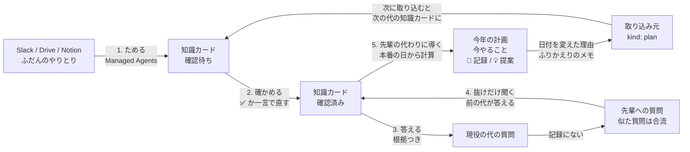

# senpai-note

**毎年メンバーが入れ替わる組織のための「1代上の先輩」ノート。**
前の代がいなくても現役の代が回せるように、アプリが先輩の代わりをします。

> **senpai-note** is a "one-generation-up senpai" notebook for organizations whose members rotate every year, such as a school festival committee. A Claude Managed Agent turns everyday Slack / Drive / Notion conversations into evidence-backed knowledge cards (what, when, why). The outgoing generation verifies them with one click or a one-line reply. When the new generation enters this year's festival date, an agent builds this year's plan from the verified cards and shows, unprompted, what to do now, what went wrong last year, and a suggestion for this year. Questions are answered only from verified cards, with links to the original posts. Anything not on record becomes a question for the seniors, and their answer becomes a new card. The date changes and notes the new generation leaves on the plan become cards for the generation after them.

Built with Claude: Japan 2026（テーマ1「あなたにしかない深さを。」）の応募作品です。

- デモ: https://senpai-note.vercel.app （合言葉が必要です）
- データはすべて架空の「若葉祭実行委員会 総務局」です（Slack 68件・Drive 5件・Notion 3件）

## 一言説明

ふだんのやりとりから、エージェントが「何を・いつ・なぜ」の知識カードを作り、前の代（B4）が ✅ で確かめます。現役の代（B3）が今年の本番の日を入れると、エージェントが確認済みの知識カードから今年の年間計画を作り、「今やること」と、昨年の問題・今年のアドバイスを先輩のほうから示します。記録にないことだけを先輩に聞き、現役の代が計画に残した記録は次の代の知識カードになります。

## 解く問題

大学の学園祭実行委員会では、1年が次のように回ります。

| 時期 | 出来事 |
|---|---|
| 4月 | 新入生が部門員になる |
| 9月中旬 | 本番 |
| 9月下旬 | 引き継ぎ会。部門員だった B3 が次の代の部門長になる |
| 10月〜2月 | 前の代（B4）は実務訓練で学校を離れる。新しい部門長は、入学して半年で年間計画を始める |
| 4月〜 | 前の代が大学院生として戻り、相談役になる |

**一番困るのは10月〜2月です。** 新しい部門長が一番聞きたい時期に、前の代は学校にいません。連絡はつきますが返事は遅く、「昨年はどうでしたか？」と聞いてから答えが来るまで何日もかかります。

前の代の答えには、手順だけでなく**時期・理由・例外・過去の失敗**が入っています。たとえば「出店場所は7月第3週に確定する（看板の発注に間に合わせるため）」のような知識です。これが人の頭と Slack のチャンネルにしか残らず、翌年には消えます。しかも新しい代は、何を聞けばよいかも、今が何をする時期なのかもわかりません。

学生団体、PTA、町内会など、「毎年メンバーが入れ替わり、経験者がすぐいなくなる組織」に共通する問題です。

## 5つの流れ



1. **ためる**: 取り込みエージェントが投稿と資料を読み、「何を・いつ・なぜそう決めたか」を1枚に1つずつ知識カードにします。どの知識カードにも根拠（元の投稿）と、どの代のやり方か（代）が付きます。同じ知識は1枚に統合し、古い資料と新しい投稿が食い違えば新しい代のやり方を正として「以前は〜だった」と書きます。
2. **確かめる**: 前の代は ✅ を押すか、知識カードごとにエージェントと話して直すだけです。理由がわからない知識カードでは、エージェントのほうから「なぜこの日にしたのですか？」と尋ねます。
3. **答える**: 現役の代の質問に、前の代が確かめた知識カードだけを根拠に答えます。元の Slack の投稿や資料まで開いて確かめられます。
4. **抜けだけ聞く**: 知識カードで答えられない質問は「先輩への質問」になります。似た質問は1つに合流させます。実務訓練中の先輩が遅れて答えると、その答えが確認済みの知識カードになり、質問した人にも届きます。
5. **先輩の代わりに導く**（この作品の中心）: 現役の代が今年の本番の日を入れると、計画づくりのエージェントが確認済みの知識カードから今年の年間計画を作ります。「本番の6週間前」「6月中」のような時期を今年の日付に計算し、項目ごとに 📘 昨年までの記録と 💡 エージェントの提案を付けます。現役の代が日付を変えた理由やふりかえりのメモは取り込み元（`kind: plan`）になり、次に取り込むと次の代の知識カードになります。こうして代がつながります。

## 画面

### 登録 `/register`

ログインは作らず、最初に開いたときに次を入れてもらいます。登録はブラウザの cookie に残り、「誰が確かめたか」「誰が直したか」の記録に使います。

- 役: **現役の代（B3）** か **前の代（B4）**
- 代: 担当する（した）本番の年で数えます（例: 2027年度の代＝2027年の本番を担当する代）。今日の日付から、現役なら今年度の代、前の代ならその1つ前を初めから入れておきます
- 部門: 局長・会場・備品・申請
- 名前
- 本番の日: 現役の代で、その代で最初に登録した人だけが入れます。入れるとすぐ計画づくりが始まります。2人目からは入力済みの日を見せるだけです

登録したあとは、現役の代は `/kouhai`、前の代は `/senpai` だけを使います（middleware が振り分けます）。右上のメニューから「登録し直す」で役や代を変えられます。

### 現役の代 `/kouhai`

- **今年の計画**
  - いちばん上に **今やること**（期限を過ぎた項目と、30日以内にやる未完了の項目）
  - 月ごとの計画。担当の部門で絞り込めます（最初は登録した部門と局全体の項目）
  - 項目ごとに 📘 昨年までの記録と 💡 エージェントの提案。前の代が ✅ した提案は「先輩が確認した提案」と表示します。どれも根拠の知識カードと元の投稿を開けます
  - 完了のチェック、日付の変更（理由が必須）、メモ・ふりかえり、項目の追加と削除
- **質問する**
  - 確認済みの知識カードだけを根拠にした回答と、元の投稿
  - 記録にないときは「記録にないので、前の代の先輩に聞いています」と出し、先輩が答えると回答が届きます
  - 確認済みの知識カードの一覧

### 前の代 `/senpai`

- **新しいやりとりを取り込む**: 取り込みエージェントを動かします
- **確認待ち / 確認済み**: 最初は自分の代の知識カードだけを出します（「すべての代」で前の代のものも見られます）。理由がわからない知識カードには「理由が不明」と出ます。知識カードを開くと、根拠の投稿と、エージェントとの修正の会話が出ます
- **エージェントの提案**: 現役の代の計画に付いた提案を ✅ するか、却下します
- **後輩からの質問**: まとめられた先輩への質問に、一言で答えます

現役の代と前の代の画面では、初めて開いたときと「？ 使い方」を押したときに、画面を1か所ずつ説明するツアーが出ます。

## ただの RAG チャットボットとの違い

| | RAG のチャットボット | senpai-note |
|---|---|---|
| 何を元に答えるか | 質問のたびに、生の資料の断片を探す | 前もって作り、先輩が確かめた**知識カード**だけ |
| 誰から動くか | 聞かれるまで何もしない | 本番の日を入れると、**先輩のほうから**「今やること」と昨年の問題・アドバイスを示す |
| 古い資料・食い違い | 古い資料も拾って、そのまま答える | 取り込むときに新しい代のやり方を正として1枚にまとめ、「以前は〜」と書く |
| 理由（なぜ） | 書かれていなければ出てこない | 理由のない知識カードを見つけ、先輩に尋ねる |
| 事実と推測 | 混ざって出てくる | 📘 記録（知識カードにあること）と 💡 提案（エージェントの考え。先輩の ✅ 待ち）を分けて出す |
| 答えられないとき | 「わかりません」で終わる | 先輩への質問にまとめ、答えが知識カードになって知識が増える |
| 代をまたぐと | 資料が積み重なるだけ | 現役の代が計画に残した日付の変更理由・ふりかえりが、**次の代の知識カードになる** |
| 先輩の手間 | 資料を整理する人が要る | ✅ を押すか、一言答えるだけ |

デモのデータには、2025年版の古い「教室使用申請の手順」（紙の用紙に押印）が入っています。RAG ならこの手順をそのまま答えかねませんが、senpai-note は取り込みの段階で Slack の新しい投稿（Web フォームに変わった）と突き合わせ、「Web フォームで出す。以前は紙だった」という知識カードにします。

## Claude の使いどころ

| 処理 | 使っているもの | ツール | 入力 → 出力 |
|---|---|---|---|
| 取り込み `POST /api/ingest` | **Claude Managed Agents**（エージェントと環境は `scripts/setup-agent.ts` で一度だけ作る） | カスタムツール `create_card` / `update_card` | 未処理の取り込み元＋既存の知識カード → 確認待ちの知識カード（重なるものは統合） |
| 修正の会話 `POST /api/cards/[id]/chat` | Messages API のツール使用 | `update_card` / `confirm_card` | 知識カード＋根拠＋会話 → 返信と知識カードの更新 |
| 質問への回答 `POST /api/questions` | Messages API のツール使用 | `answer` / `report_gap` | 質問＋確認済みの知識カード → 根拠つきの回答、または先輩への質問（似た質問には合流） |
| 先輩の回答 `POST /api/senpai-questions/[id]/answer` | Messages API のツール使用 | `create_card` / `answer_kouhai` | 先輩への質問＋先輩の答え → 確認済みの知識カードと、元の質問への回答 |
| 計画づくり `POST /api/plan` | Messages API のツール使用 | `add_plan_item`（項目と、その項目のアドバイスを一緒に渡す） | 本番の日＋確認済みの知識カード（代つき）＋今日の日付 → 今年の計画の項目と、📘 記録 / 💡 提案 |

- モデルは `claude-opus-5-5`（adaptive thinking、effort は medium）
- **ベクトル検索は使いません。** 知識カードは数十〜数百枚の想定なので、確認済みの知識カードをすべてコンテキストに入れ、プロンプトキャッシュで使い回します
- **根拠のチェックはサーバーでします。** ツールの呼び出しは Route Handler で受け、Firestore に書く前に確かめます
  - 知識カードには根拠（`sourceIds` か `answerIds`）が必ず1件以上要ります。実在しない取り込み元の id を根拠にすると、ツールがエラーを返します
  - 回答・計画・アドバイスの根拠に、確認済みでない知識カードを使うと、ツールがエラーを返します
  - 理由が根拠に書かれていなければ `why: null` にさせ、修正の会話で先輩に尋ねます
  - 📘 記録は知識カードに書かれていることだけ、💡 提案は前の代が ✅ するまで「確認待ち」として表示します
- 拒否されたときは、サーバー側のフォールバック（`fallbacks: "default"`）で別のモデルが続けます
- Claude API はサーバー側からだけ呼び、API キーをブラウザに出しません

### デモデータで動かした結果

- 取り込み: 76件の投稿・資料から知識カード22枚（約1分40秒）
- 計画づくり: 2027年度の代、本番 2027/9/11 で、計画の項目22件・アドバイス29件（約2分）

計画の項目の例:

| 項目 | 📘 昨年までの記録 | 💡 エージェントの提案 |
|---|---|---|
| 備品を数える（11月） | 昨年は自前のテントが12張、うち2張は脚が曲がっていた | 2張が使えなければ自前は10張なので、6月に町内会から借りる8張で足りるか早めに考える |
| 教室使用申請（7/31） | — | 締切の7/31は土曜日なので、昨年と同じく7月の頭に出す |
| 体育会との調整会議（6月） | 昨年は雨の日の決まりがなく、当日の朝まで混乱した | 調整会議の結果をもとに、7月までに雨天時の決まりを作る |

## 技術構成とディレクトリ

- Next.js 15（App Router, TypeScript, Tailwind CSS）
- Firestore（`firebase-admin` をサーバー側だけで使う）
- Vercel
- `@anthropic-ai/sdk`

```
src/
  app/
    register/      登録の画面（役・代・部門・名前・本番の日）
    kouhai/        現役の代の画面（今年の計画・質問）
    senpai/        前の代の画面（取り込み・確認・修正の会話・提案の確認・先輩への質問）
    login/         合言葉の画面
    api/           Route Handler（Claude を呼ぶのはここだけ）
  components/
    kouhai/        今年の計画のタブ（PlanTab）と質問のタブ（AskTab）
    CitedCards.tsx 根拠の知識カードと元の投稿
    ProfileMenu.tsx 右上のメニュー（登録し直す・使い方）
    Tour.tsx       画面を1か所ずつ説明するツアー
  lib/
    ingest.ts      取り込み（Managed Agents のセッションを動かし、カスタムツールを受ける）
    ingestAgent.ts 取り込みエージェントのシステムプロンプトとツール
    agents.ts      修正の会話・質問への回答・先輩の回答
    planAgent.ts   計画づくり
    cardTools.ts   知識カードのツールの定義と、根拠のチェック
    claude.ts      Messages API のツール使用のループ
    db.ts          Firestore
    profile*.ts    登録（cookie）
  middleware.ts    合言葉と、登録に合わせた画面の振り分け
data/demo/         架空のデモデータ（Slack 68件・Drive 5件・Notion 3件）
scripts/
  setup-agent.ts   取り込みエージェントと環境を作る（更新する）
  seed.ts          デモデータを Firestore に入れる
```

## 動かし方

```sh
npm install
cp .env.example .env.local   # ANTHROPIC_API_KEY, FIREBASE_SERVICE_ACCOUNT_BASE64, DEMO_PASSCODE を書く

# 取り込みエージェント（Managed Agents）を作り、出てきた2つの ID を .env.local に書く
npx tsx --env-file=.env.local scripts/setup-agent.ts

# 架空のデモデータを Firestore に入れる
# --reset を付けると、知識カード・質問・計画・アドバイス・代も消してやり直す
npx tsx --env-file=.env.local scripts/seed.ts --reset

npm run dev
```

- `FIREBASE_SERVICE_ACCOUNT_BASE64` は、Firebase のサービスアカウントの JSON を base64 にしたものです（`base64 -i key.json | tr -d '\n'`）
- `DEMO_PASSCODE` を空にすると、合言葉を聞きません

試す順番:

1. http://localhost:3000 を開き、**前の代**（例: 2026年度の代・備品・野口）で登録する
2. 「新しいやりとりを取り込む」を押す。確認待ちの知識カードを ✅ するか、話して直す（「すべての代」に切り替えると、2025年度の代の知識カードも出ます）
3. 別のブラウザ（またはシークレットウィンドウ）で **現役の代**（例: 2027年度の代・会場・西田）で登録し、本番の日（例: 2027-09-11）を入れる。今年の計画ができる
4. 「質問する」で質問する。記録にない質問は、前の代の画面の「後輩からの質問」に届く

## データについて

- `data/demo/` は、Claude と一緒に作った架空の組織のデータです。人名・建物名・電話番号はすべて架空です
- 「理由が書かれていない決定」「年によって変わったやり方」「記録にない例外」を混ぜ、抜けの処理がデモで起きるようにしています
- 実在の組織の Slack のデータは、問題を確かめるためだけに読み、リポジトリには入れていません

## まだできていないこと

- **取り込みの定期実行**（Managed Agents の scheduled deployments）。今は前の代の画面の「新しいやりとりを取り込む」ボタンで動かします
- **本物の Slack・Drive・Notion とのつなぎこみ**。デモは `data/demo/` の JSON を Firestore に入れて使います
- **本物の認証と権限**。デモでは名前は自己申告で、デプロイ先は合言葉で守っているだけです。運用するときは、Cloudflare Zero Trust のメールアドレス認証をアプリの前に置き、合言葉をやめて、登録の名前を認証したメールアドレスに結びつける予定です

わざと作らないもの: 時期が来たら知らせる通知。「今やること」は画面を開いたときに見えるだけです。
