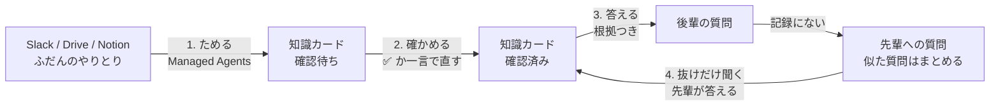

# senpai-note

**毎年メンバーが入れ替わる組織のための「1代上の先輩」ノート。**
ふだんのやりとり（Slack・Drive・Notion）から、エージェントが「何を・いつ・なぜ」の知識カードを作ります。先輩が確かめ、後輩は根拠つきで質問でき、記録にないことだけを先輩に聞きます。

> A "one-generation-up senpai" notebook for organizations whose members rotate every year. A Claude agent turns everyday Slack / Drive / Notion conversations into evidence-backed knowledge cards, the outgoing generation verifies them with a single click or a one-line reply, the new generation asks questions and gets answers with sources — and only what isn't on record is turned into a question for the seniors.

Built with Claude: Japan 2026（テーマ1「あなたにしかない深さを。」）の応募作品です。

- デモ: https://senpai-note.vercel.app （合言葉が必要です）
- データはすべて架空の「若葉祭実行委員会 総務局」です

## 解く問題

大学の学園祭実行委員会では、毎年9月に代替わりします。新しい部門長は入学して半年で、10月から年間計画などを始めます。ところが、その時期の前の代（B4）は実務訓練で学校にいません。連絡はつきますが、「去年はどうでしたか？」と聞いても、返事が来るまで何日もかかります。

前の代の答えには、手順だけでなく、**時期・理由・例外・過去の失敗**が入っています。これが人の頭と Slack のチャンネルにしか残らず、翌年には消えていきます。学生団体、PTA、町内会など、「毎年メンバーが入れ替わり、経験者がすぐいなくなる組織」に共通する問題です。

## 4つの流れ



1. **ためる** — 取り込みエージェントが投稿と資料を読み、「何を・いつ・なぜそう決めたか」を1枚に1つずつ知識カードにします。どのカードにも根拠（元の投稿）が付きます。同じ知識は1枚に統合し、年によってやり方が変わったときは新しいほうを正として「以前は〜だった」と書きます。
2. **確かめる** — 先輩は ✅ を押すか、カードごとにエージェントと話して直すだけです。理由がわからないカードでは、エージェントのほうから「なぜこの日にしたのですか？」と尋ねます。
3. **答える** — 後輩の質問に、先輩が確かめたカードだけを根拠に答えます。元の Slack の投稿や資料まで確かめられます。
4. **抜けだけ聞く** — カードで答えられない質問は「先輩への質問」になります。似た質問は1つにまとめます。実務訓練中の先輩が遅れて答えると、その答えがカードになり、質問した後輩にも届きます。

## ただの RAG チャットボットとの違い

| | RAG のチャットボット | senpai-note |
|---|---|---|
| 何を元に答えるか | 質問のたびに、生の資料の断片を探す | 前もって作り、先輩が確かめた**知識カード**だけ |
| 古い資料・食い違い | 古い資料も拾って、そのまま答える | 取り込むときに新しいほうを正として1枚にまとめる |
| 理由（なぜ） | 書かれていなければ出てこない | 理由のないカードを見つけ、先輩に尋ねる |
| 答えられないとき | 「わかりません」で終わる | 先輩への質問にまとめ、答えがカードになって知識が増える |
| 先輩の手間 | 資料を整理する人が要る | ✅ を押すか、一言答えるだけ |

デモのデータには、2025年版の古い「教室使用申請の手順」（紙の用紙に押印）が入っています。RAG ならこの手順をそのまま答えかねませんが、senpai-note は取り込みの段階で Slack の新しい投稿（Web フォームに変わった）と突き合わせ、「Web フォームで出す。以前は紙だった」というカードにします。

## Claude の使いどころ

| 処理 | 使っているもの | ツール |
|---|---|---|
| 取り込み `POST /api/ingest` | **Claude Managed Agents**（エージェントと環境は `scripts/setup-agent.ts` で一度だけ作る） | カスタムツール `create_card` / `update_card` |
| 修正の会話 `POST /api/cards/[id]/chat` | Messages API のツール使用 | `update_card` / `confirm_card` |
| 質問への回答 `POST /api/questions` | Messages API のツール使用 | `answer` / `report_gap` |
| 先輩の回答 `POST /api/senpai-questions/[id]/answer` | Messages API のツール使用 | `create_card` / `answer_kouhai` |

- モデルは `claude-opus-5-5`（adaptive thinking）
- **ベクトル検索は使いません。** カードは数十〜数百枚の想定なので、確認済みのカードをすべてコンテキストに入れ、プロンプトキャッシュで使い回します
- 取り込みエージェントのカスタムツールは、サーバー（Route Handler）で受けて Firestore に書きます。根拠の id が実在しないカードは作れません。回答で確認済みでないカードを根拠にすると、ツールがエラーを返します
- 拒否されたときは、サーバー側のフォールバック（`fallbacks: "default"`）で別のモデルが続けます
- Claude API はサーバー側からだけ呼び、API キーをブラウザに出しません

## 技術構成

- Next.js 15（App Router, TypeScript, Tailwind CSS）
- Firestore（`firebase-admin` をサーバー側で使う）
- Vercel
- `@anthropic-ai/sdk`

```
src/
  app/
    kouhai/        後輩の画面（質問・回答・知識カード）
    senpai/        先輩の画面（取り込み・確認・修正の会話・先輩への質問）
    api/           Route Handler（Claude を呼ぶのはここだけ）
  components/      画面の部品とツアー
  lib/
    ingest.ts      取り込み（Managed Agents のセッションを動かす）
    agents.ts      修正の会話・質問への回答・先輩の回答
    cardTools.ts   知識カードのツールの定義と、根拠のチェック
    db.ts          Firestore
data/demo/         架空のデモデータ（Slack 68件・Drive 5件・Notion 3件）
scripts/           エージェントの作成、デモデータの投入
```

## 動かし方

```sh
npm install
cp .env.example .env.local   # ANTHROPIC_API_KEY, FIREBASE_SERVICE_ACCOUNT_BASE64, DEMO_PASSCODE を書く

# 取り込みエージェント（Managed Agents）を作り、出てきた ID を .env.local に書く
npx tsx --env-file=.env.local scripts/setup-agent.ts

# 架空のデモデータを Firestore に入れる（--reset で知識カードや質問も消してやり直す）
npx tsx --env-file=.env.local scripts/seed.ts --reset

npm run dev
```

`FIREBASE_SERVICE_ACCOUNT_BASE64` は、Firebase のサービスアカウントの JSON を base64 にしたものです（`base64 -i key.json | tr -d '\n'`）。

## データについて

- `data/demo/` は、Claude と一緒に作った架空の組織のデータです。人名・建物名・電話番号はすべて架空です
- 実在の組織の Slack のデータは、問題を確かめるためだけに読み、リポジトリには入れていません

## まだできていないこと

- 取り込みの定期実行（Managed Agents の scheduled deployments）。今は先輩の画面の「新しいやりとりを取り込む」ボタンで動かします
- 本物の Slack・Drive・Notion とのつなぎこみ（デモは JSON のデータを使います）
- ログインと権限（デモでは役を画面上部で切り替え、デプロイ先は合言葉で守っています）
